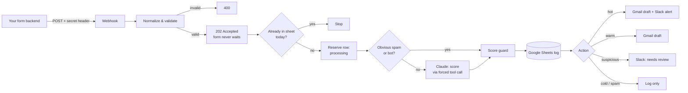

# AI Lead Qualification & Instant Follow-up (n8n + Claude + Slack + Gmail + Sheets)

**Every website lead is scored and logged within seconds. Hot leads are flagged in Slack with a personalised reply already drafted for your approval.**

<!-- Replace with your recording: docs/demo.gif (see docs/demo-video-script.md) -->

- **Scores every enquiry 0–100 with plain-English reasons.** Claude compares the lead with *your* ideal customer, so a multi-site business with a budget ranks above a student's research question.
- **Drafts the reply for you.** Hot leads get a Gmail draft and a Slack alert that contains the draft; warm leads get a draft. A person approves each reply before it goes out, and auto-send is a single setting.
- **Logs every lead to Google Sheets, even when something breaks.** If the AI is down, slow or returns nonsense, transparent rules take over and the lead is flagged for review. The sheet is written before any email or Slack step runs.

> Tested and runs without API keys: 23 unit tests, plus an end-to-end test in a real n8n instance against a mock Claude API.

---

## 5-minute demo (no accounts needed)

Requirements: n8n (`npm install -g n8n`; current n8n needs Node.js 24+). The unit tests alone run on Node.js 20+.

```bash
npm test                      # unit tests for the Code-node logic
npm run demo                  # imports a sandbox copy into n8n and runs 8 sample leads
npm run demo:ai-down          # same, but the AI is "down": watch the rules fallback
```

Output of `npm run demo`:

```
score  tier   action           scored_by            review  lead
   96  hot    draft_and_alert  ai                   no      Maria Lopez <maria@brightdental.example>
   60  warm   draft            ai                   no      Tom Becker <tom@northstar-logistics.example>
   12  cold   log_only         ai                   no      Jamie Chen <jamie.chen@studentmail.example>
   10  cold   review_alert     ai                   yes     Eve <eve@corp-procurement.example>
    0  spam   log_only         rules (pre-filter)   no      Rank Pro <offers@rankpro-seo.example>
    0  spam   log_only         rules (pre-filter)   no      John Smith <john.smith@mailinator.example>

Rejected as invalid: not-an-email
Stopped as duplicate: maria@brightdental.example
```

"Eve" is a prompt-injection attempt. The mock AI is *deliberately* fooled into scoring it 100. The workflow's code still caps the score, drafts nothing and asks a person to look instead.

---

## How it works



| Outcome | When | What happens |
| --- | --- | --- |
| Hot | score ≥ 75 | Gmail draft and a Slack alert containing the draft. Auto-send applies only if enabled and nothing was flagged |
| Warm | score 45–74 | Gmail draft |
| Needs review | form text tries to instruct the AI | Slack alert only. No AI-written reply is drafted |
| Cold | score < 45 | Logged only |
| Spam | vendor pitch, honeypot field filled, or AI says spam | Logged only. The AI is skipped where the pre-filter catches it |

---

## Set it up with your accounts (about 20 minutes)

1. **Import the workflows.** Import `workflow/ai-lead-qualifier.json` and `workflow/error-alerts.json` into n8n (*Workflows → Import from file*).
2. **Create the credentials in n8n** and select them on each node. Nothing secret is stored in the workflow file.
   - *Lead form webhook*: **Header Auth** credential. Name `X-Webhook-Secret`, value: a long random string.
   - *Claude: score lead*: **Header Auth** credential. Name `x-api-key`, value: your Anthropic API key.
   - *Google Sheets* (3 nodes), *Gmail* and *Slack*: use n8n's built-in OAuth credentials.
3. **Create the sheet.** Make a Google Sheet with a tab called `Leads` and paste in the header row from `samples/sheet-header.csv`. Put the sheet URL into all three Google Sheets nodes.
4. **Edit the `⚙️ Settings` node.** Set your business description, ideal customer, thresholds, sender name and Slack channel.
5. **Turn on error alerts.** In *Workflow settings → Error workflow*, choose "AI Lead Qualifier – error alerts". Its Slack channel is set inside that workflow and defaults to `#sales-leads`.
6. **Connect your form.** Send submissions from **your backend, a serverless function, or a form tool's webhook feature** (Tally, Typeform, Webflow and similar) to the production webhook URL, with the secret header added there.
   - Never put the secret in public website JavaScript.
   - Flat JSON (`name`, `email`, `company`, `website`, `message`, `source`) works as-is, and fields nested under `data` or `fields` are also accepted. Other shapes need a small mapping step.
   - `docs/form-snippet.html` is a minimal front-end example with a honeypot field.
7. **Test before you go live.** Submit one lead and check the sheet row, the Gmail draft and the Slack alert.

---

## Reliability & safety

| Risk | How it's handled |
| --- | --- |
| Strangers hitting the webhook and running up AI costs | Shared-secret header auth (403 without it), field lengths capped, obvious spam skips the AI |
| Prompt injection in the form | Form text is wrapped as untrusted data with its angle brackets removed. The model never chooses recipients, links or the routing outcome; code derives those from the score. Known injection phrasing in any field caps the score and routes to human review. Links, bare domains, phone numbers, HTML and other email addresses are stripped from AI replies. This contains the damage, but pattern matching cannot catch every attack, which is why a human approves replies by default |
| AI down, slow or returning garbage | 30 s timeout, 3 tries 2 s apart, then rule-based scoring. The lead is still logged and flagged `needs_review` |
| Gmail / Slack / Sheets hiccups | The sheet is written before email or Slack. Sheets steps retry and never block the rest. A failed Gmail or Slack step triggers the error workflow |
| Repeat submissions and webhook retries | Deterministic `lead_id` from email, message and day. A duplicate check runs **before** any AI call or email, and the row is reserved as `processing` right after the check. Two clicks within about a second can still both get through, so the form snippet also disables the button after the first click |
| Spreadsheet formula injection | Sheets writes use RAW mode, so a message starting with `=` is stored as text |
| Slack formatting abuse | Form text is escaped, so it can't `@channel` or show fake links |
| Personal data | The model receives only first name, company, website, email *type* and message, not the email address (unless someone types it into the message). Lead data is stored in your Google Sheet and, by default, in n8n's execution history. Turn off *Save successful executions* in workflow settings if you don't want that |

## Running cost

Measured on the sample leads against the real API, each lead uses about 1,400 input and 400–560 output tokens with Claude Haiku 5.5. That is **roughly $0.40 per 1,000 leads** at Anthropic's published rates ($0.10 per million input tokens, $0.50 per million output tokens), excluding retries. Spam caught by the pre-filter costs nothing. This is an estimate; check [current pricing](https://platform.claude.com/docs/en/about-claude/pricing).

## Adapt it to your business

- **CRM instead of Sheets:** swap the Google Sheets nodes for HubSpot, Pipedrive, Airtable or Notion. The guard's output already uses CRM-style fields.
- **Your scoring criteria:** edit `businessDescription` and `idealCustomer` in Settings and tune the thresholds.
- **Other channels:** add Teams, WhatsApp or SMS alerts after the Switch node.
- **Instant acknowledgement:** add a fixed, non-AI "thanks, we got it" email for every valid lead.

---

## For developers

```
src/            Code-node logic (plain JS, no dependencies): settings, normalize, rules, request, guard
scripts/        build-workflow.mjs injects src/ into the workflow JSON; inline.cjs is shared with the tests
workflow/       generated n8n workflows (import these)
test/           logic.test.cjs (unit), e2e.mjs (real n8n + mock Claude)
mock/           mock-claude.mjs with ok / down / garbage modes
samples/        sample leads, sheet header row
docs/           form snippet, demo video script
```

- **The Code nodes are generated from `src/`**, so the tested code and the deployed code cannot drift. Edit `src/`, then run `npm run build`.
- **Claude is called with a forced tool call** (`tool_choice: {type: "tool"}`) and a JSON schema. The guard validates the output anyway: it clamps the score, checks the enums and caps the length.
- **The end-to-end test** runs the real n8n engine with Google, Gmail and Slack nodes disabled and a simulated sheet lookup. Before going live, run one lead through your real accounts (setup step 7).
- **If n8n isn't on your PATH**, set `N8N_BIN`: `N8N_BIN=/path/to/n8n npm run demo`.

## Related

[Inquiry Desk](https://github.com/helloyansquared/inquiry-desk-n8n-ai-automation) is the local-first sibling of this project. It uses n8n with a local model (Ollama) to turn messy sales inquiries into structured records, with no cloud services. This project goes a step further: it scores leads and connects to Gmail, Slack and Google Sheets.

---

Built by **Yanyan Wang** ([Yan Squared](https://github.com/helloyansquared)). All sample data is synthetic. MIT licensed.
